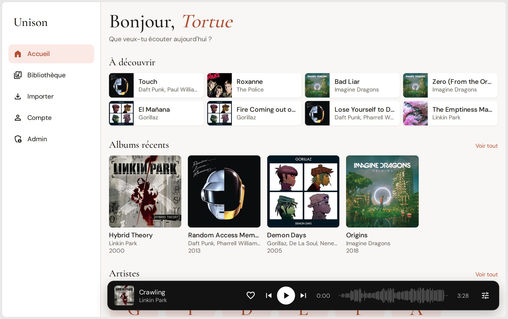
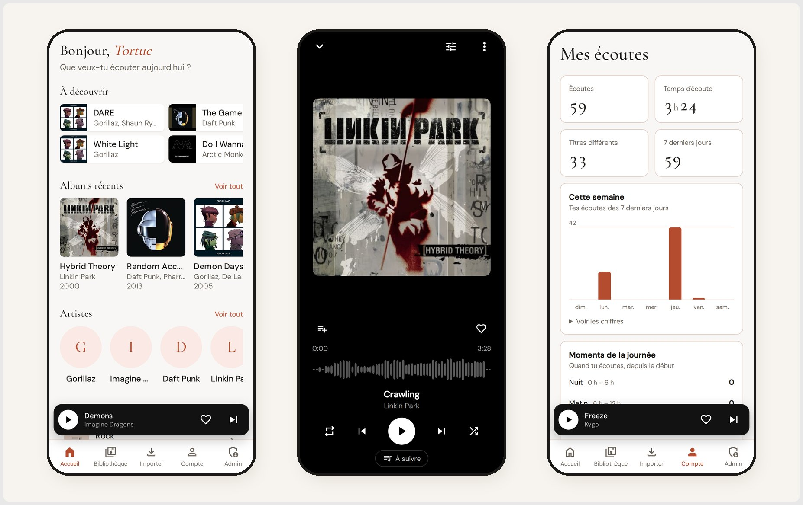

# Unison

Une application de musique auto-hébergée, pour un petit cercle de proches. On colle un lien YouTube (ou on cherche un titre), Unison télécharge le son, le range dans une bibliothèque commune, et on l'écoute partout : sur ordinateur comme sur téléphone, écran éteint compris.





Unison tourne chez moi, sur un Raspberry Pi 5, à l'adresse https://unison.pi5.ovh (sur invitation : pas d'inscription ouverte). Cette version 2 est une réécriture complète de la [première version](https://github.com/Progress-cmd/pi5_unison), en Symfony.

## Ce que ça fait

**Écouter**
- Une bibliothèque commune : titres, albums, artistes, et pour chacun ses playlists et ses favoris.
- Un lecteur complet : file d'attente (« Écouter juste après », « Ajouter à la file »), aléatoire, répétition, et reprise là où on s'était arrêté, d'un appareil à l'autre.
- Les commandes du système (écran verrouillé, notification, touches multimédia), des raccourcis clavier, et l'écoute écran éteint sur téléphone.
- « Paramètres audio » : volume, et choix de la sortie (enceintes, casque) sur ordinateur.
- « Mes écoutes » : statistiques (semaine, moments de la journée, titres et artistes préférés) et historique complet.

**Ajouter de la musique**
- Une recherche qui montre d'abord ce qui est déjà dans la bibliothèque, puis les titres et albums de YouTube Music, à importer d'un clic.
- Ou des liens collés : vidéos, titres YouTube Music, playlists entières.
- Le téléchargement se fait en arrière-plan : audio, pochette, forme d'onde, titre nettoyé (sans « (Official Video) », « [HD] »…), artistes et albums reconnus.

**Administrer**
- Tableau de bord : contenu, imports, écoutes, palmarès, place sur le disque.
- Erreurs à régler (imports, recherches, pages, erreurs JavaScript des navigateurs), avec « Relancer » et « Réglé ».
- Contenu : corriger un titre, fusionner des artistes, supprimer un titre ou un album.
- Comptes : création avec un lien par e-mail pour choisir son mot de passe, rôle admin, désactivation.
- Annonces affichées une fois à chaque compte, et maintenance des fichiers (audio ou pochettes manquants, fichiers orphelins, cookies YouTube).

Et quelques surprises à découvrir.

## Technique

| | |
| --- | --- |
| Application | PHP 8.4, Symfony 7.4, Doctrine ORM, MariaDB |
| Interface | Twig, Turbo et Stimulus (Hotwire), AssetMapper : pas d'étape de build JavaScript |
| Téléchargement | yt-dlp et ffmpeg, dans un worker Symfony Messenger |
| Hébergement | Docker (image multi-étapes : dev et production), Traefik devant, e-mails par Resend |

Le code est rangé par domaine dans `src/` :

| Dossier | Rôle |
| --- | --- |
| `Account` | comptes, connexion, mot de passe oublié |
| `Library` | titres, albums, artistes, favoris |
| `Playlist` | playlists |
| `Playback` | lecture : flux audio, file d'attente, reprise |
| `History` | écoutes et « Mes écoutes » |
| `Import` | recherche, téléchargement (yt-dlp), pochettes, nettoyage des titres |
| `Announcement` | annonces |
| `Admin` | administration |
| `Legacy` | reprise des données de la v1 (temporaire) |
| `Shared` | ce qui sert partout |

## Lancer en local

Il faut Docker et `make`.

```bash
cp .env.exemple .env                 # puis remplir les mots de passe et APP_SECRET
make build                           # construit l'image et démarre app, worker, base et Mailpit
make composer c="install"
make console c="importmap:install"
make console c="doctrine:migrations:migrate"
make console c="app:user:create moi@exemple.fr Moi motdepasse --admin"
```

- L'application : http://localhost:8083
- Les e-mails envoyés en dev (liens de mot de passe) : http://localhost:8025
- `make` seul liste les raccourcis : logs, shell, console, client SQL, worker…

Les commandes passent par `-u www-data` : les fichiers créés dans le conteneur appartiennent à ton utilisateur.

## En production

Tout est décrit dans [deploy/README.md](deploy/README.md) : la stack Docker du serveur, ses secrets, la mise à jour sur un tag (`git checkout v2.x.y` puis `update.sh`), la sauvegarde et la restauration.

## Versions

Une version mineure par fonctionnalité (`v2.24.0` les annonces, `v2.25.0` les statistiques de l'admin…), un tag annoté pour chacune ; la production suit les tags.
